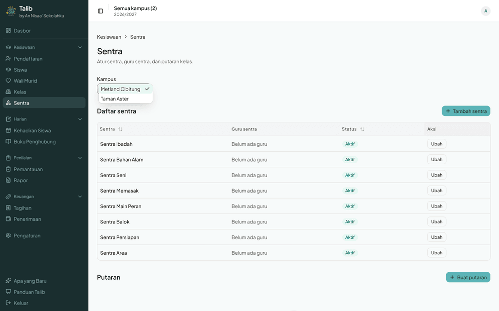
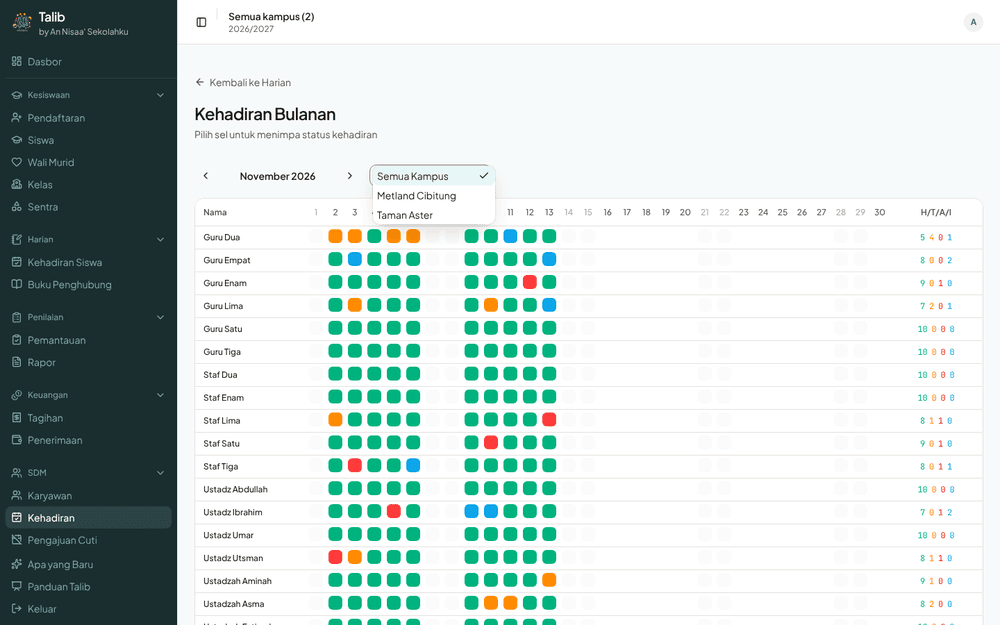
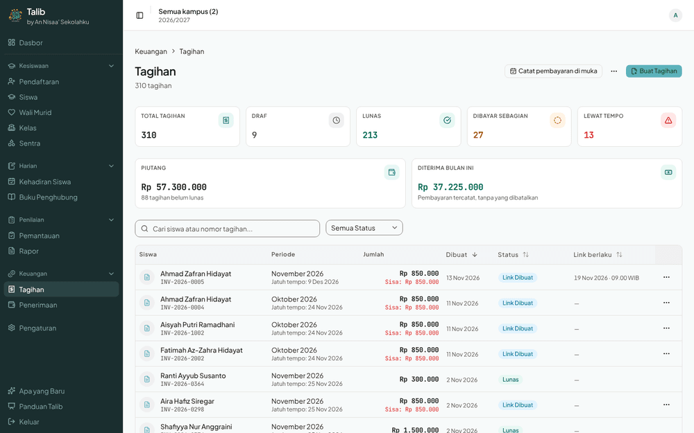
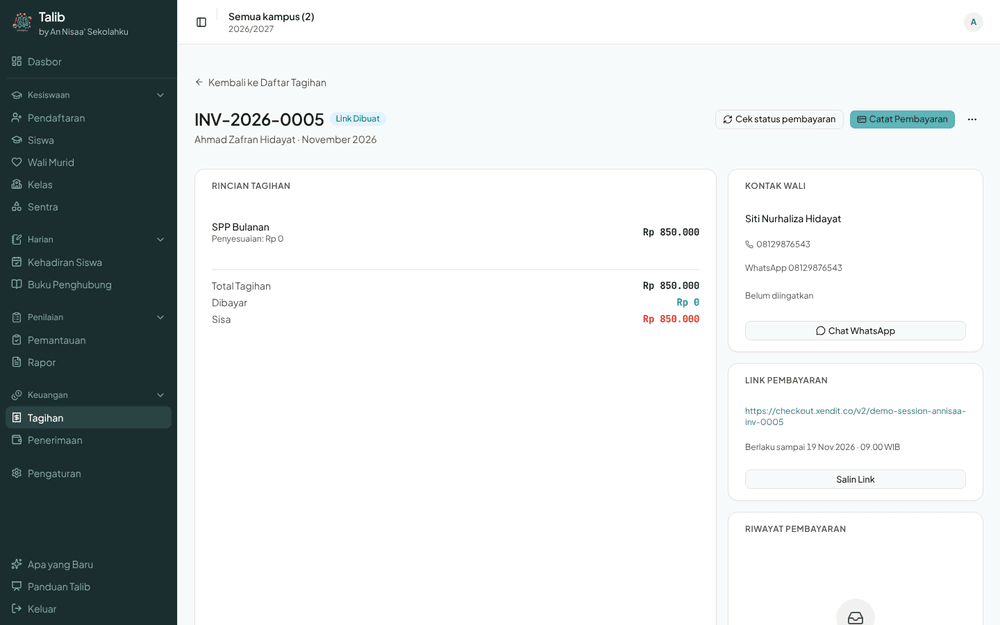
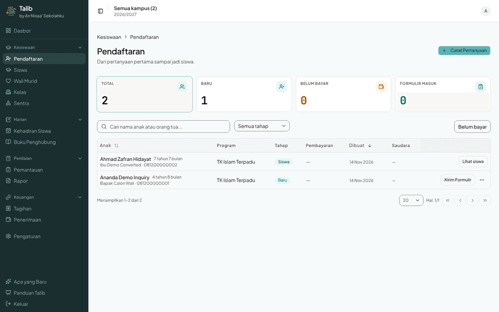
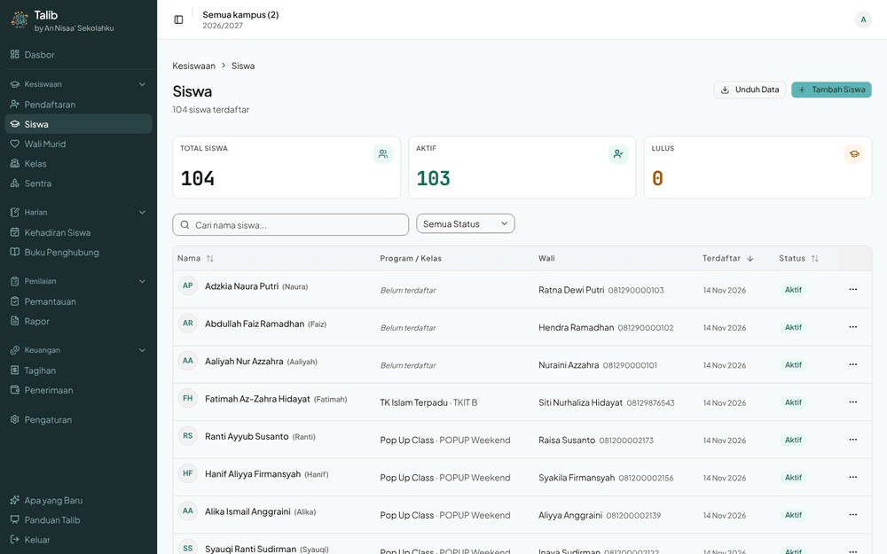
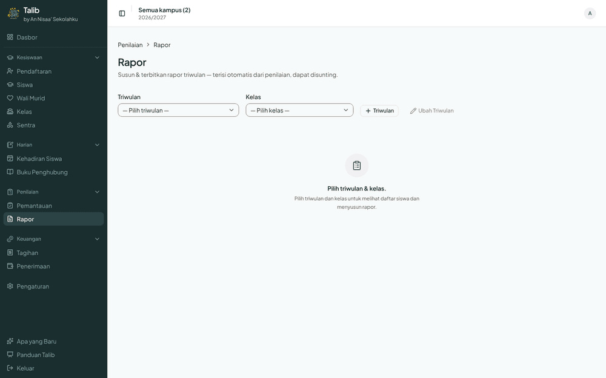
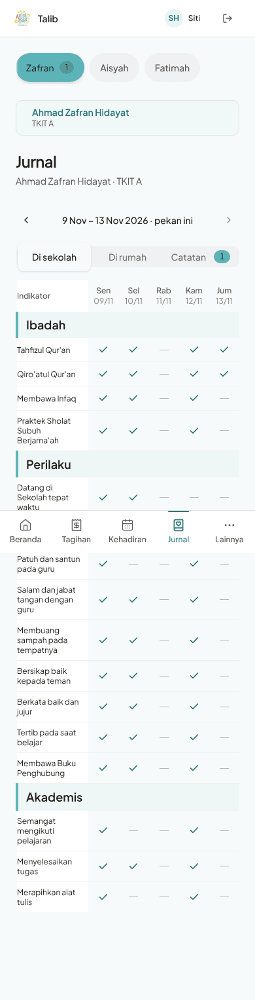
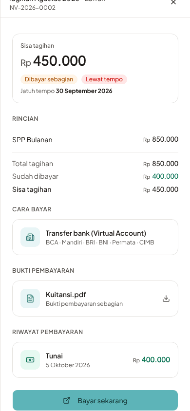
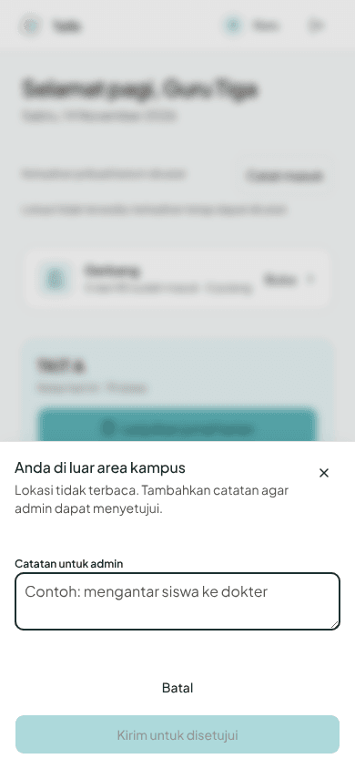

# UI/UX Audit and Roadmap: Admin, Teacher, Parent (local production build)

- **Date:** 2026-11-14 (a Saturday — see [Limits](#limits-read-before-acting))
- **Build under test:** `origin/staging` @ `a0afa580`, `next build` + `next start`, `DEMO_MODE=true`.
- **Data:** disposable local Postgres 16, `prisma db push` + `prisma db seed` (104 students, 310 invoices, 28 employees, 2 campuses). No staging or production access.
- **Viewports:** admin 1440×900 (plus 390×844 on the pages an admin uses on a phone); teacher and parent 390×844 touch.
- **Method:** five Haiku agents drove the real UI with Playwright (admin ×3, teacher, parent): they swept all 69 portal routes, opened every picker and primary dialog, and walked the persona jobs in `docs/uat/jobs/`. One Sonnet agent swept the code for the same patterns. The lead reviewer checked the key screenshots by eye and the main code anchors by hand.
- **Measured against:** `.claude/standards/{patterns,ui,portal,voice,colors}.md`, `design-system.html`, and CLAUDE.md § Product principle ("don't make me think").
- **Screenshots:** the key ones are inline below, from `assets/2026-11-14-ui-ux-audit/`. Cycle record: `docs/cycles/2026-11-14-ui-ux-audit.md`.

## How to use this document (for Codex, Claude, opencode)

This is a **pointer, not a spec**. Each roadmap item says what we saw, where, and a suggested direction. Before you build one:

1. **Re-verify first.** Run the item's *Verify before fixing* steps against a fresh local build (or staging, where the item says so). File:line anchors are from `a0afa580` and will drift; grep for the symbol, not the line. If the finding no longer reproduces, or the evidence was wrong, write that in your cycle doc's `## Context` and close the item instead of building it.
2. **Check the direction, don't copy it.** "Suggested direction" is one reviewer's idea. Your `spec` stage owns the design; where an item lists a **Decision needed**, ask the user in `spec` — do not pick silently.
3. **One roadmap item = one cycle** unless it says "split". Put the item ID (e.g. `UX-R2`) in the cycle doc's `## Context` and in the PR title, so this table can be ticked off.
4. **Tick it off here.** When an item ships, change its Status to `done (#PR)` in the [Roadmap](#roadmap) table in the same PR. When you disprove one, set `dropped — <reason>`.

Finding IDs (`ADM1-…`, `ADM2-…`, `ADM3-…`, `TCH-…`, `PAR-…`, `CODE-…`) are listed in the [Finding catalogue](#finding-catalogue) at the bottom.

## Summary

Every route loaded in about 2 s or less with zero app console errors, zero failed requests and no horizontal overflow at 390 px; tap targets on the teacher and parent portals are ≥44 px; both portal bottom navs are consistent. The **teacher portal is the strongest**: class, date and campus are detected, and class attendance is 2 taps ("S" on one child, then "Tandai 18 siswa lainnya Hadir").

The problems are systemic rather than local, and most break rules **we already wrote down**:

1. **Names are not doors.** ~34 places show a student, class, guardian or employee by name with no link to its page — including the invoice list, where the student name opens the *invoice*, and the invoice detail, which has no link to the student or wali at all. (`ui.md` "name is the link".)
2. **Campus is asked, not known.** The admin header *looks* like a campus scope ("Semua kampus (2)") but is static text; Sentra and the three staff-attendance pages each ask again, forget the answer on the next page, and Sentra silently defaults to the first campus. (`patterns.md` § Don't make me think: "campus comes from … never a dropdown".)
3. **The shared Select lays its popup over its own trigger** (90 call sites, zero overrides). This is the "feels off" in the reported screenshot; with the full staging campus names the shared prefix "An Nisaa' Sekolahku …" is all you read.
4. **Same job, different shape.** Admin list pages disagree on stat cards (filter vs display), primary-button placement, and back navigation; `PageHeader primaryAction` is used by 1 page, 18 hand-roll it.
5. **Defaults and day-awareness are missing in a few high-traffic places:** Rapor opens with both pickers empty; on a non-school day the parent home says "Belum dicatat" for every child and the teacher's weekly assessment is a dead end.
6. **Parents' money path:** once a payment link exists, "Bayar sekarang" is the last element of a sheet taller than the screen.

| Portal | Routes | Findings | Major | Minor | Bug-class |
|---|---:|---:|---:|---:|---:|
| Admin · people & academic (ADM1) | 15 | 8 | 4 | 4 | 0 |
| Admin · finance, assessment, daily ops (ADM2) | 14 | 10 | 4 | 6 | 1 |
| Admin · HR & settings (ADM3) | 17 | 5 | 2 | 3 | 0 |
| Teacher (TCH) | 15 | 5 | 2 | 3 | 1 |
| Parent (PAR) | 8 | 16 | 5 | 11 | 1 |
| Code sweep (CODE) | — | 10 systemic | — | — | — |

## Limits (read before acting)

- **Saturday run.** Teacher weekly scoring, `/teacher/sessions/[id]`, staff daily attendance and parent "today" states were only seen in their non-school-day form. Re-check UX-R7 and UX-R11 items on a weekday.
- **Seed campus names are short** ("Taman Aster"); staging/production use the full "An Nisaa' Sekolahku …" names (CLAUDE.md § Multi-LLM Safety 1). The repeated-prefix problem (UX-R3) is verified only from the reported staging screenshot — verify it on staging, read-only.
- **Demo auth, headless Chromium.** No geolocation (check-in inside the radius untested), no Xendit return, no real email/WhatsApp.
- **Not tested:** SCHOOL_ADMIN negative access, exports, payroll run creation, holiday add, user invite, journal writes, sign-out.
- Haiku agents are weak at visual judgement: every VISUAL finding cited below was confirmed by the lead reviewer on the screenshot, or is marked *hypothesis*.

## Roadmap

Priority: **P1** = user-visible every day, or the user named it; **P2** = clear friction on a core job; **P3** = consistency polish. Size: S ≤ ½ day, M ≤ 2 days, L = needs a design decision and several slices.

**Suggested order:** Wave 1 quick wins (UX-R3a, UX-R9, UX-R12) → Wave 2 foundations that need a decision (UX-R1, UX-R2 rule) → Wave 3 apply the foundations module by module (UX-R2 slices, UX-R4, UX-R7) → Wave 4 polish (UX-R5, UX-R6, UX-R8, UX-R10, UX-R11).

| ID | Item | Prio | Size | Portals | Decision needed | Status |
|---|---|---|---|---|---|---|
| UX-R1 | Real campus scope in the admin header; pages stop asking | P1 | L | admin | yes | open |
| UX-R2 | Every named entity is a link ("names are doors") | P1 | L (split) | all | yes (rule) | open |
| UX-R3 | Select popup below its trigger; short campus labels; one picker per kind of choice | P1 | S + M | all | no | open |
| UX-R4 | Admin list pages share one shape | P2 | M | admin | yes | open |
| UX-R5 | One primary action per screen | P3 | S | admin | no | open |
| UX-R6 | Undo over confirm; canonical confirm labels | P3 | M | admin, teacher | no | open |
| UX-R7 | Smart defaults and non-school-day awareness | P2 | M | all | no | open |
| UX-R8 | Status colours and vocabulary mean one thing | P3 | M | all | yes (glossary) | open |
| UX-R9 | Parent pay path: one "Bayar" button, always visible | P1 | S | parent | no | open |
| UX-R10 | Parent child context and plain words | P2 | M | parent | no | open |
| UX-R11 | Teacher: names open the child; journal row; weekly dead end | P2 | S | teacher | no | open |
| UX-R12 | Small bugs found on the way | P1 | S | admin, teacher | no | open |

---

### UX-R1 — Real campus scope in the admin header; pages stop asking

- **Priority** P1 · **Size** L · **Sensitive path:** tenant/role logic → label the PR `needs-staging-verify`.
- **Problem.** `app/admin/layout.tsx:22` renders "Semua kampus (2)" as plain text: it looks like a scope control but does nothing. Pages that need a campus each ask again:
  - `app/admin/sentra/client.tsx:65,215` — always shows a picker (even with one campus) and silently defaults to the first campus; a new sentra saves there without saying so (ADM2-05).
  - `app/admin/(hr)/employee-attendance/{page.tsx:51,320, daily/page.tsx:46,178, monthly/page.tsx:47,120}` — three sibling pages, three separate `useState("all")` pickers; the choice is lost on the next page and never matches the header (ADM3-02).
  - `app/teacher/gate/client.tsx:238` is the good example: hidden with one campus, default resolved server-side.
- **Evidence.**  
- **Verify before fixing.**
  1. Local build, `u_school_admin`: open `/admin/sentra` — the header says all campuses, the page has picked one.
  2. Open `/admin/employee-attendance/monthly`, pick Metland Cibitung, then open `/admin/employee-attendance/daily` — it is back to "Semua Kampus".
  3. Grep for other per-page campus state: `rg -n 'campusId|"all"' app/admin -g '*.tsx' | rg -i campus`.
  4. Check whether any admin role is meant to be campus-bound (`lib/admin/header-context.ts` lists all tenant campuses; `lib/sentra/access.ts` scopes *teachers* by campus). If some admin is campus-bound, the header scope must respect it.
- **Suggested direction.** Make the header campus an interactive switcher ("Semua kampus" + each campus), saved per user (cookie or user preference), exposed to server and client pages. Pages that list data filter by it; pages that need exactly one campus (Sentra) use the header campus, and when the header is "Semua kampus" show one inline prompt with the reason ("Sentra diatur per kampus — pilih kampus") instead of a silent default. Remove the page-level pickers. Hide the switcher entirely for single-campus tenants.
- **Decision needed.** (a) Remember per user or per browser? (b) Does "Semua kampus" stay a valid scope on every page, or do some pages force a single campus? (c) Does the teacher portal ever need it (today: no)?
- **Done when.** No admin page owns campus state; changing campus in the header changes every campus-aware page and survives navigation and reload; Sentra never writes to a campus the user didn't see named; `e2e/sentra.spec.ts` and an employee-attendance spec cover it.

### UX-R2 — Every named entity is a link ("names are doors")

- **Priority** P1 · **Size** L, **split into slices** (finance → academic → HR → master data → portals) · this is the user's own example.
- **Problem.** `ui.md` requires the identity column to be the link (`DataTableLinkCell`), but is silent on *other* entities named in a row or on a detail page. Result: ~34 plain-text sites, and lists that disagree on where a student name goes.
  - **Finance (worst).** Invoice list "Siswa" column links to the *invoice* (`app/admin/invoices/invoices-client.tsx:92-107`); invoice number is plain text; row type has no student id. Payments list same (`app/admin/payments/page.tsx:167,178`). Invoice detail header name and KONTAK WALI name are plain text — zero links to `/admin/students` or `/admin/guardians` (`app/admin/invoices/[id]/page.tsx:617,831`) (ADM2-01, ADM2-02). Meanwhile `/admin/student-attendance` links the same name to the student.
  - **Class names** plain on student list/detail, guardian children, attendance: `students/page.tsx:403`, `students/[id]/page.tsx:671`, `kelas-saat-ini.tsx:30`, `children-list.tsx:34`, `student-attendance/page.tsx:388,404` (ADM1-01, ADM1-02).
  - **Guardians list** child names plain (ADM1-03); **admissions** guardian plain (ADM1-04).
  - **Employees** plain on daily (`daily/page.tsx:213`), monthly (`monthly/page.tsx:170`), pending approvals (`pending-approvals.tsx:108`), leave requests, payroll detail, class teachers section (ADM3-01). Main attendance (`employee-attendance/page.tsx:210`) does it right.
  - **Journal student pages** (`/admin/student-journal/students/[id]`) are reachable from no list, and their name doesn't link back (ADM2-03).
  - **Master-data tables** with no name link, row opens only via `⋯`: campuses, holidays, roles, users, academic years, fees, salary components, keringanan, work queue (CODE-9).
  - **Portals:** teacher class-attendance / weekly / center rosters (TCH-01), parent profile and invoices child names (CODE-1).
- **Evidence.**  
- **Verify before fixing.**
  1. `u_school_admin` → `/admin/invoices`, tap a student name: you land on the invoice. On the invoice detail, try to reach the student: ~4 taps plus a search.
  2. Re-run the DOM count per page: `document.querySelectorAll('a[href^="/admin/students/"]').length` (and `/guardians/`, `/classes/`, `/employees/`).
  3. Re-grep the code-sweep list: `rg -n 'student\.name|employee\.nama|classSection\.name' app components -g '*.tsx'` and check each hit has an enclosing link.
- **Suggested direction.** First write the rule into `ui.md` (this is the decision): "In a list, the row's own subject is the identity link; any *other* entity named in the row or on a detail page links to that entity's page." Then add one small `EntityLink` helper (student / guardian / class / employee / invoice → href) so the slices are mechanical. For finance: the identity cell becomes the invoice number (link to invoice), the student name links to the student. On teacher rosters where the row is a tap target for status, link the name only and keep the status control separate.
- **Decision needed.** Confirm the rule above, especially for finance lists (which link is "the row"?).
- **Done when.** The rule is in `ui.md`; every site in the list links (or is listed in the cycle doc as deliberately not linked, with reason); a Vitest per helper; the e2e invoice spec asserts the student link.

### UX-R3 — Select popup below its trigger; short campus labels; one picker per kind of choice

- **Priority** P1 (R3a), P3 (R3c) · **Size** R3a S, R3b S, R3c M.
- **Problem.**
  - **R3a.** `components/ui/select.tsx:111` defaults `alignItemWithTrigger = true` (macOS-style item alignment). The open list covers its own field and, in grids, the content beside it; 0 of 90 `SelectContent` call sites override it. Confirmed on `/admin/sentra` and `/admin/employee-attendance/monthly` (ADM2-04).
  - **R3b.** Campus names render raw (`{c.name}`) in 8 option lists (`employees/page.tsx:607`, `employee-attendance/page.tsx:324`, `daily/page.tsx:184`, `monthly/page.tsx:124`, `employees/[id]/page.tsx:441`, `sentra/client.tsx:222`, `teacher/gate/client.tsx:255`, `classes/client.tsx`). On staging every option starts "An Nisaa' Sekolahku …", so the distinguishing word is last — the reported screenshot. Class labels already got a short-label fix (`class-section-picker.tsx:87`); campuses didn't.
  - **R3c.** Same choice, three controls: 20 `NativeSelect` sites (report cards, templates, changelog, class bulk sheet, teacher weekly), shadcn `Select` (47 files), `ClassSectionPicker` combobox (CODE-7).
- **Verify before fixing.** R3a: open any Select at 1440 and 390 and screenshot. R3b: **read-only** on staging, open `/admin/sentra` or an employee-attendance picker and confirm the prefix; check what `Campus` fields exist for a short name (`prisma/schema.prisma`). R3c: re-count `rg -c NativeSelect app components`.
- **Suggested direction.** R3a: flip the default to `false` (popup opens below, trigger stays visible) and walk the main pickers at both viewports — one line, wide blast radius, so verify-local must screenshot several. R3b: a `campusShortLabel()` in `lib/format.ts` that strips the shared tenant prefix (or a `shortName` column if the prefix isn't uniform) — and UX-R1 removes most of these pickers anyway. R3c: write the rule into `ui.md` (e.g. shadcn `Select` ≤ ~10 options, combobox with search above, `NativeSelect` only where the standard already allows it) and migrate.
- **Done when.** No popup covers its trigger; no option list repeats the tenant prefix; `ui.md` names one control per kind of choice.

### UX-R4 — Admin list pages share one shape

- **Priority** P2 · **Size** M · **Decision needed:** are stat cards filters or display?
- **Problem.** `/admin/students`, `/guardians`, `/admissions`, `/classes`, `/academic-years` are each built differently (ADM1-05):
  - stat cards are filters on Admissions (TOTAL ringed), display-only on Students and Guardians;
  - Admissions has a "Belum bayar" outline button in the toolbar that duplicates the "Belum bayar" stat card and shows no on/off state (ADM1-06);
  - the primary action sits in the header on some pages and in the toolbar on others; Guardians has none;
  - Academic years is two stacked tables with no row links;
  - detail pages navigate back by breadcrumb on some ("Kesiswaan › Pendaftaran") and by a "← Kembali ke Daftar Tagihan" link on others (invoice detail, staff monthly);
  - `PageHeader primaryAction` is used by 1 page (`invoices-client.tsx:819`); 18 hand-build header buttons with mixed `size="sm"` and labels (bare "Tambah" at `employees/page.tsx:402`) (CODE-5);
  - settings sub-pages split between "list + dialog" and "narrow card + save at the bottom" (ADM3-04).
- **Evidence.**  
- **Verify before fixing.** Screenshot the five list pages side by side at 1440; tap a stat card on each; `rg -n 'actions=\{' app/admin` vs `rg -n 'primaryAction=' app/admin`.
- **Suggested direction.** Pick the stat-card rule once (recommendation: stat cards are filters everywhere, with a visible selected state, because Admissions proves the pattern), record it in `patterns.md` Recipe 1, migrate headers to `primaryAction`, one back-navigation pattern for detail pages (breadcrumb, which the layout already provides), and one settings-form layout.
- **Done when.** The five list pages and the settings sub-pages match Recipe 1 / Recipe 3 as written; no hand-built header buttons remain.

### UX-R5 — One primary action per screen

- **Priority** P3 · **Size** S.
- **Problem.** Two filled buttons on one view: `/admin/sentra` ("Tambah sentra" and "Buat putaran"); `/admin/students/[id]` for an unplaced student on phone ("Daftarkan ke Kelas" twice, ADM1-08). `employee-attendance/page.tsx:288-293` makes a *navigation* link the filled button and nests `<Button>` in `<Link>` (CODE-5).
- **Verify before fixing.** Screenshot each; `rg -n '<Link[^>]*>\s*<Button' app components`.
- **Suggested direction.** Section-level actions become outline; nav links become links; `render={<Link/>}` per repo standard.
- **Done when.** Each screen has at most one filled button.

### UX-R6 — Undo over confirm; canonical confirm labels

- **Priority** P3 · **Size** M.
- **Problem.** Only 4 undo toasts exist. Reversible in-flow actions still confirm: `components/student-journal/class-day-grid.tsx:122-130` (clear marks — `ui.md` lists "clearing" as undo), `components/admin/classes/detail/roster-section.tsx:202`, `teachers-section.tsx:185`, `app/admin/student-attendance/page.tsx:646`, `keluarga-section.tsx:604`; `invoices/[id]/page.tsx:727` is an alert dressed as a confirm. About 13 confirm labels drift from the canonical table (destructive without "Ya,", reversible with it; `employees/[id]/page.tsx:660` paints "Nonaktifkan" red) (CODE-6). Leave approval confirms (ADM3-03) — defensible because it writes attendance; keep.
- **Verify before fixing.** Re-read `ui.md` § Undo or confirm; open each site and decide reversible vs not.
- **Done when.** Each listed site is either undo-toast or justified in the cycle doc; labels match the table.

### UX-R7 — Smart defaults and non-school-day awareness

- **Priority** P2 · **Size** M · **Re-verify on a weekday.**
- **Problem.**
  - `/admin/report-cards` opens with "— Pilih triwulan —" and "— Pilih kelas —"; nothing shows until both are chosen (ADM2-08).
  - Parent home on a non-school day: every child "Belum dicatat", no hint that it's a holiday (PAR-08).
  - Teacher `/teacher/assessments/weekly` on a non-school day: "Belum ada pekan aktif", and the next active week isn't offered (TCH-05).
  - Date fields with no default where today is the common answer: `components/admin/sentra/rotation-dialog.tsx:48,68`, `components/teacher/leave-sheet.tsx:137,225` (CODE-2).
- **Evidence.** 
- **Suggested direction.** Rapor: default to the active triwulan and the last class used. Parent home and teacher weekly: read the school calendar (holidays + weekends) and say "Hari ini libur" / offer "Pekan berikutnya: 16 Nov" in one tap. Date fields: default to today.
- **Done when.** Each screen opens showing the likely answer; non-school days say so.

### UX-R8 — Status colours and vocabulary mean one thing

- **Priority** P3 · **Size** M · **Decision needed:** the glossary entries in `voice.md`.
- **Problem.**
  - Colour tokens reused across meanings: "Sakit" and "Dibayar Sebagian" share the amber `late` token; "Link Dibuat" uses the sky `leave` token (ADM2-09). Attendance colour maps are hand-rolled in 5 files; teacher "Alpa" uses `bg-destructive` while the badge map uses `bg-status-absent-subtle` (`app/teacher/class-attendance/page.tsx:48`). Staff monthly grid has no colour legend; parent journal grid has no legend for ✓ / — (PAR-05).
  - Terms drift: "Nonaktif" 7 vs "Tidak Aktif" 20 (both on `app/admin/fees/page.tsx:88,395`), "Draft" vs "Draf", "Wali Murid" vs "Wali", "Orang Tua"/"Ustadzah" chips vs jobs-file "GURU/WALI" (PAR-16). Jargon: "TA" in the enroll picker (ADM1-07); parent-facing "Alpa", "bilah", "sebaran", "pekan aktif", "sejak", "Virtual Account" (PAR-03, PAR-07, PAR-09).
  - Dates: 9 formatters bypass `lib/format.ts` (`components/attendance/{override-modal,calendar}.tsx`, `class-sessions-calendar.tsx`, three journal pages with their own `formatWeekLabel`); parent invoices mix "30 Sep 2026" and "30 September 2026" (PAR-15).
- **Evidence.** 
- **Suggested direction.** One shared attendance status map (component + tokens), a payment-state token set separate from attendance, a legend wherever colour or ✓/— carries meaning, a `voice.md` glossary row per drifting term, and date formatting only through `lib/format.ts`.
- **Done when.** Same status = same colour everywhere; `rg` for the losing variant of each term returns nothing in UI strings.

### UX-R9 — Parent pay path: one "Bayar" button, always visible

- **Priority** P1 · **Size** S.
- **Problem.** Once a payment link exists, "Bayar sekarang" is the last element of a ~950 px sheet on an 844 px screen, and the sheet title scrolls away with it (PAR-01). Before that, the button says "Buat link pembayaran" — a parent doesn't know what a "link" is; total path from home is 4 taps plus a scroll (PAR-02). The fallback "hubungi bagian tata usaha" has no phone or WhatsApp action (PAR-11; may be a seed gap — check whether a school contact is configurable).
- **Evidence.** 
- **Verify before fixing.** `u_rightjet` at 390×844 → Tagihan → an unpaid invoice → create the link → measure where "Bayar sekarang" lands. Re-read `docs/uat/jobs/parent.md` JTBD-PARENT-INV-01 (it specifies the "Buat link" label — update the job if the flow changes).
- **Suggested direction.** A sticky footer in the sheet holding one "Bayar Rp 450.000" button that creates the link if needed and opens it; "Buat link" survives only as error recovery. Contact: render `tel:` / `wa.me` when the school number is set.
- **Done when.** From home, paying is ≤3 taps with no scroll; the parent e2e covers it.

### UX-R10 — Parent child context and plain words

- **Priority** P2 · **Size** M.
- **Problem.** The child switcher is pinned and remembered on Tagihan, Kehadiran, Jurnal and Rapor, but Perkembangan has none (list of cards; detail has only a "Pilih anak" back link) (PAR-06). The short name rule is invisible ("Zafran" pill vs "Ahmad Zafran Hidayat" card) (PAR-14). `/changelog` drops the parent shell and shows staff items under "Untuk orang tua" (PAR-10). Per-child links on home are small text, repeated with identical accessible names (PAR-12). Unlabelled "1" badges in the journal (PAR-04). Paid history is collapsed with no "Lunas" count (PAR-13).
- **Suggested direction.** Same `PortalTabs` child switcher on Perkembangan detail; one short-name rule; render `/changelog` inside the portal layout filtered to the parent audience; label badges.
- **Done when.** Switching child works the same on all five parent sections.

### UX-R11 — Teacher: names open the child; journal row; weekly dead end

- **Priority** P2 · **Size** S.
- **Problem.** Class-attendance names lead nowhere (TCH-01, part of UX-R2). The journal roster row expands in place while the week view hides behind a right-hand icon, unlike the jobs file (TCH-02). The week view is read-only, with one "Isi hari ini" link (TCH-04, hypothesis — re-check on a weekday). TCH-05 is in UX-R7.
- **Suggested direction.** The name is a link to the child's week page; the rest of the row keeps its current tap behaviour; update `docs/uat/jobs/teacher.md` to match whatever ships.

### UX-R12 — Small bugs found on the way

- **Priority** P1 · **Size** S each · ship together.
- **TCH-03** — With no location, the check-in sheet title says "Anda di luar area kampus" while the body says "Lokasi tidak terbaca". The jobs file (JTBD-TEACHER-HOME-03 scenario C) expects "Lokasi tidak terbaca" as the title. 
- **ADM2-07** — `/admin/student-journal/students/[id]` highlights "Pengaturan" in the sidebar instead of "Buku Penghubung".
- **ADM2-06** — Journal monitoring shows two rows "KB / Kelompok Bermain" with no campus; you can't tell which is which.
- **CODE-4** — Missing route `loading.tsx`: `app/admin/(hr)/employee-attendance/daily`, `app/admin/sentra/rotations/[id]`.
- **ADM3-05** (hypothesis) — Payroll detail net delta reads "Rp -118.182vs periode lalu" with no gap; check the screenshot zoomed.

---

## Finding catalogue

Raw agent notes (with every screenshot) were kept outside the repo; the IDs below are stable for cross-reference. Sev: M = major, m = minor.

| ID | Sev | Cat | Where | One line | Item |
|---|---|---|---|---|---|
| ADM1-01 | M | DMMT | /admin/students/[id] | Class name (subtitle, Kelas saat ini, Riwayat) not a link | R2 |
| ADM1-02 | M | DMMT | /admin/students | Program/Kelas cell not a link | R2 |
| ADM1-03 | M | DMMT | /admin/guardians | Child name in Siswa column not a link | R2 |
| ADM1-04 | m | DMMT | /admin/admissions, /admin | Guardian/program not links; inquiry has no page | R2 |
| ADM1-05 | M | CONS | 5 admin lists | Stat cards, primary action, toolbar all differ | R4 |
| ADM1-06 | m | CONS | /admin/admissions | "Belum bayar" toolbar toggle duplicates stat card, no state | R4 |
| ADM1-07 | m | DMMT | enroll dialog | "TA" jargon; two KB rows differ only by campus suffix | R8 |
| ADM1-08 | m | CONS | /admin/students/[id] phone | Two "Daftarkan ke Kelas" primaries | R5 |
| ADM2-01 | M | DMMT | /admin/invoices(+[id]) | Student name opens invoice; detail has no student/wali link | R2 |
| ADM2-02 | m | CONS | invoices, payments vs attendance | Same name opens different pages | R2 |
| ADM2-03 | M | DMMT | /admin/student-journal/students/[id] | Unreachable from any list; name not a link | R2 |
| ADM2-04 | m | VIS | /admin/sentra | Select popup covers its trigger | R3 |
| ADM2-05 | M | DMMT | /admin/sentra | Asks campus under "Semua kampus" header; silent default | R1 |
| ADM2-06 | M | DMMT | journal monitoring | Two "KB" classes indistinguishable | R12 |
| ADM2-07 | m | BUG | journal student page | Sidebar highlights Pengaturan | R12 |
| ADM2-08 | m | DMMT | /admin/report-cards | Both pickers empty on open | R7 |
| ADM2-09 | m | CONS | invoices, attendance | Sakit = Dibayar Sebagian colour; "leave" token for link status | R8 |
| ADM2-10 | m | VIS | /admin/invoices phone | Names wrap 2–3 lines; ~4 rows per screen | R4 |
| ADM3-01 | M | DMMT | HR pages | Employee names not links (daily, monthly, leave, payroll) | R2 |
| ADM3-02 | M | CONS | employee-attendance ×3 | Own campus picker per page, forgotten, out of sync with header | R1 |
| ADM3-03 | m | DMMT | /admin/leave-requests | Approve confirms (keep; justified) | R6 |
| ADM3-04 | m | CONS | /admin/settings/* | Two layouts for settings sub-pages | R4 |
| ADM3-05 | m | VIS | /admin/payroll/[id] | Delta text runs into amount (hypothesis) | R12 |
| TCH-01 | M | DMMT | /teacher/class-attendance | Student names lead nowhere | R2, R11 |
| TCH-02 | m | DMMT | journal entry | Row expands; week view behind an icon; jobs doc differs | R11 |
| TCH-03 | M | BUG | /teacher check-in sheet | Title "di luar area" vs body "tidak terbaca" | R12 |
| TCH-04 | m | DMMT | journal week view | Read-only week, one "Isi hari ini" link (hypothesis) | R11 |
| TCH-05 | m | DMMT | /teacher/assessments/weekly | Non-school day dead end; next week not offered | R7 |
| PAR-01 | M | DMMT | invoice sheet | "Bayar sekarang" below the fold, nothing pinned | R9 |
| PAR-02 | m | DMMT | invoice sheet | "Buat link pembayaran" step; "link" unexplained | R9 |
| PAR-03 | m | DMMT | invoices | "sejak", "Virtual Account", "Kuitansi.pdf" wording | R8 |
| PAR-04 | m | DMMT | journal | Unlabelled "1" badges | R10 |
| PAR-05 | M | DMMT | journal week grid | No legend for ✓ / —; blank day reads as "teacher forgot" | R8 |
| PAR-06 | M | CONS | perkembangan | No child switcher; detail only "Pilih anak" back link | R10 |
| PAR-07 | m | DMMT | attendance | "Alpa" shown to parents | R8 |
| PAR-08 | M | DMMT | /parent home | Non-school day shows "Belum dicatat" for all | R7 |
| PAR-09 | m | DMMT | perkembangan detail | "bilah", "sebaran", "pekan aktif" | R8 |
| PAR-10 | m | CONS | /changelog | Drops parent shell; staff items in parent tab | R10 |
| PAR-11 | M | BUG | profile, invoice sheet | "Hubungi tata usaha" with no number or action (maybe seed) | R9 |
| PAR-12 | m | DMMT | /parent home | Per-child links small, repeated accessible names | R10 |
| PAR-13 | m | DMMT | invoices | Paid history collapsed, no Lunas count | R10 |
| PAR-14 | m | CONS | all parent | Short-name rule invisible | R10 |
| PAR-15 | m | CONS | invoices, journal | Mixed short/long date formats | R8 |
| PAR-16 | m | CONS | journal notes | "Orang Tua/Ustadzah" chips vs jobs "GURU/WALI" | R8 |
| CODE-1 | — | DMMT | app-wide | ~34 plain-text entity names | R2 |
| CODE-2 | — | DMMT | app-wide | Campus asked per page; date fields without today default | R1, R7 |
| CODE-3 | — | VIS | `components/ui/select.tsx:111` | Popup over trigger by default, 0 overrides; raw campus names ×8 | R3 |
| CODE-4 | — | CONS | app-wide | Page-root spacing (4 admin, 14 portal), 2 missing `loading.tsx` | R12, R4 |
| CODE-5 | — | CONS | 19 pages | `primaryAction` used once; hand-built headers; nav link as primary | R4, R5 |
| CODE-6 | — | DMMT | ~18 sites | Confirm where undo fits; label drift | R6 |
| CODE-7 | — | CONS | 20+ sites | NativeSelect / Select / combobox mixed for the same choice | R3 |
| CODE-8 | — | DMMT | HR | Employee names plain (6 sites) | R2 |
| CODE-9 | — | DMMT | 10 files | Master-data tables without a name link | R2 |
| CODE-10 | — | CONS | app-wide | Term, badge-colour and date-format drift | R8 |

## Heuristic disclaimer

This is a heuristic audit by LLM agents on a demo build, not real user testing. It cannot see thumb reach, glare, trust, or a 4-year-old phone on a slow network. Treat every item as a hypothesis worth checking, then put the change in front of a real teacher, admin or parent.
